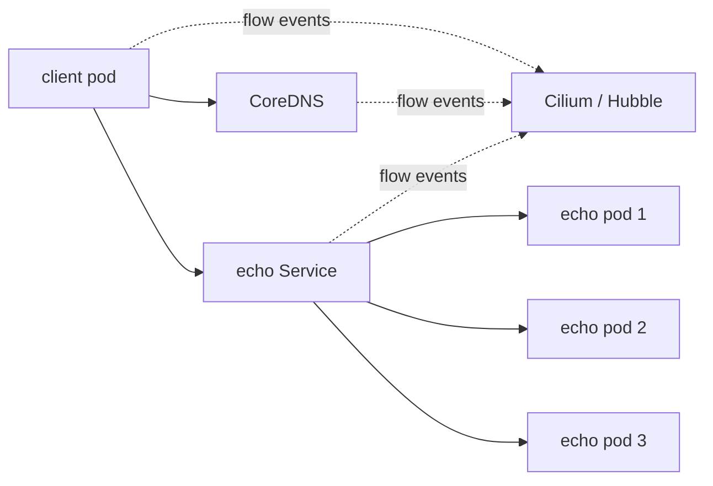

# Design for the replayable lab

The original lab covered a lot of ground. I am keeping the runnable part small enough that a reader can understand the topology before breaking it.

## Local topology

The implementation will use a named kind cluster and a dedicated namespace. It will pass the intended context explicitly to `kubectl`. A setup command must not quietly operate on whichever cluster happens to be active. A teardown command will only remove the named kind cluster after checking its name.

## Why these components

**One client and one echo Service** are enough to ask a surprising number of good questions. The client can resolve a name, open a connection, and make repeated requests. Several echo replicas let me inspect EndpointSlices and compare a Service's backend list with the backend that handled a request.

**CoreDNS and one Cilium policy** give two failure modes that can look similar from the client. In one case DNS is unavailable. In the other, a policy may deliberately drop the client's traffic. The incident guides will show how to separate them with Kubernetes state and Hubble verdicts.

**Hubble and packet capture** serve different purposes. Hubble adds workload identity and policy verdicts. A packet capture shows the packet at a particular interface. Neither should be presented as a complete view by itself.

## Boundaries

- This is a local kind lab. It does not create GCP resources or pretend a local policy is GCP IAM.
- The first runnable version will keep kube-proxy in place unless a separate, verified configuration is added for replacement. The original lab contains observations from both kube-proxy and Cilium. The current setup must make that distinction explicit.
- Cross-cluster TLS is a later extension. It needs separate cluster address ranges, an intentional entry point, and a certificate whose trust and hostname checks can be explained precisely.
- VPC routing, BGP, ECMP, and physical fabrics belong in context notes. The local cluster does not recreate a datacenter.
- The project uses public images and generic configuration.

## What counts as done

A case is complete when another developer can see the baseline, introduce one failure, inspect evidence at more than one layer, restore the system, and know which behavior was observed in the original lab versus verified while building this repo. The setup and cleanup must be repeatable and scoped to this lab.
